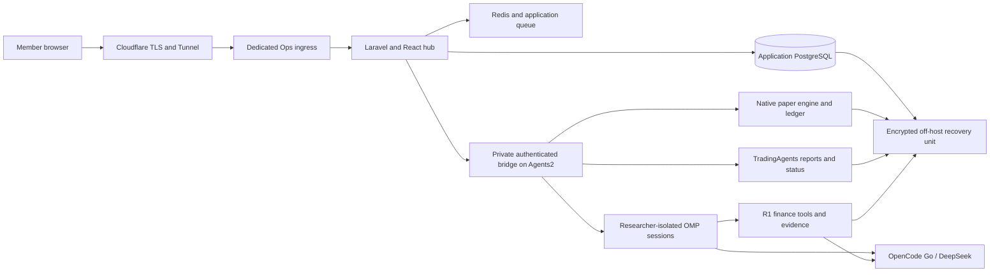

# Kernscale Trading Hub deployment design

Date: 16 November 2026. Status: owner-agreed deployment direction; frontend design continues separately. Authentication reflects the latest instruction: Laravel-managed passkeys and MFA replace the earlier Google proposal. This document records a target design, not an executed release.

## Outcome and selected approach

Create a new, independent Laravel application at `trading.kernscale.com`, deployed on Server 2 Ops. It presents the shared paper portfolio, agent activity, research, interactive R1 capabilities, discussions, review and publication in one application. TradingAgents and the authoritative paper-account engine continue on Agents2. The owner subsequently selected OMP as the interactive research harness, integrating R1 finance tools/skills through a researcher-isolated bridge.

The owner selected a new application over a module in the company Dashboard. Keeping Ghostfolio and Discourse as separate member interfaces was considered and superseded by the unified Laravel application. Their existing state is migration input and rollback material. The small Tailscale dashboard is retired after its required functions and backend dependencies are covered.

The implementation reuses Laravel packages and existing Kernscale delivery patterns. It does not rewrite the Python research or paper-account engines. The company Dashboard and `kernscale.com` website remain separate deployment boundaries.

## Agreed requirements

- One Laravel web application, one membership system and one public trading entry point.
- New Laravel app on Server 2 Ops; research and paper-account processes remain on Agents2.
- Laravel-managed accounts, passkeys and authenticator-app MFA/2FA with recovery codes. Google sign-in is superseded.
- Approved members read the shared portfolio and published research. Approved researchers additionally run R1 and submit research for review. Owners manage membership, publication and paper-trading controls.
- Private researcher sessions become shared only through an explicit authorized publication action.
- OpenCode Go/DeepSeek powers research. Add no application spending, researcher-count, daily-run or arbitrary usage quotas. Queue on actual hardware/provider backpressure; retain authentication abuse protection and technical failure handling. Existing paper risk and strategy settings remain unchanged.
- Store sessions at Kernscale; disable Tauric cloud session synchronization. Configured model/data providers still receive the inputs required for their work.
- Recovery objectives: at most one hour of data loss and four hours to restore service, subject to measured acceptance.
- Lean encrypted off-host backups: 24 hourly recovery points and seven daily points. Preserve meaningful research, sessions and portfolio history; rotate transient caches, downloads and diagnostics.
- Saved reports remain accessible during backend outages. Show portfolio observation timestamps and stale/offline status; reconcile queued or interrupted jobs before resumption.
- Direct trading-domain cutover is acceptable because the application has no external customer rollout. Retain a verified rollback route.
- Use Cult UI, Watermelon UI and React Bits selectively within one consistent React frontend. Navigation, visual treatment and detailed interaction behavior are decided in the frontend grilling.

## Frontend scope confirmed after deployment planning

The owner specified five main pages: Home dashboard; R1 Research; Agent Outputs with research awaiting review, other documents and strategies; Community; and Portfolio. Account, user/role management and useful Ghostfolio administration functions form supporting pages. Keep the main agents scheduled independently in the background; distinguish original scheduled-run outputs from interactive R1 sessions and later human-reviewed revisions. Review/publication in the app does not silently gate or change the existing execution policy.

Home leads with agent activity/latest decisions and a compact paper-portfolio summary. The R1 workspace includes previous sessions, chat and output with the composer in the lower central area, and contextual sources, metrics, a thesis/Kanban workspace and performance on the right. Display authorized agent progress, tool activity, sources and concise reasoning summaries. Strategy development/proposals and a Ghostfolio capability-parity inventory are required; the board model, editing authority and proposal workflow remain to be settled.

The approved visual direction is calm, modern, fast, clear and aligned. Desktop, tablet and mobile all require usable capabilities. The owner then selected Watermelon Capitalio as the common design baseline, the left-hand session-list reference, shadcn Base UI Chat/Trace elements and React Bits Lattice Loader, with micro-interaction refinement afterward. The [frontend/OMP design](frontend.md) records selected sources, event mappings and compatibility checks. The [earlier tool research](../../../.orchestration/research/2026-11-16-trading-hub-open-source-tools.md) remains a candidate catalog; explicit choices supersede its assistant-ui/default-chart suggestions.

## Placement and ownership

| Surface | Target and authority |
| --- | --- |
| New application source | `products/Kernscale-Trading`, with the active linked implementation checkout at `internal/Kernscale-Trading` on `codex/trading-hub`; Laravel, Inertia/React, application models, policies, integration bridge and release artifacts. |
| Web, application workers and application storage | Server 2 Ops, proposed `/srv/kernscale/apps/kernscale-trading-hub`; application PostgreSQL and Redis on isolated data networks. |
| TradingAgents | Existing `products/TradingAgents` checkout and research services on Agents2; original research configuration and schedule remain authoritative. |
| Paper account | Existing `products/Trading-CLI` engine and SQLite ledger on Agents2; no second editable ledger in Laravel. |
| Interactive OMP/R1 research | OMP runtimes on Agents2 with R1 finance tool/skill/evidence adapters; isolated sessions behind the authenticated application bridge. |
| Host admission and release control | Kernscale Hosting; add an Ops-specific application contract after live inventory. Existing Server 2 Production/VM 101 wrappers are not Ops admission. |
| Backup and monitoring | Kernscale Operations; extend the existing encrypted Restic framework with a trading-specific recovery unit and restore procedure. |

## Application and authentication packages

Use the official Laravel React/Inertia starter kit and its Fortify authentication. Enable the supported Fortify passkeys feature and use the official `@laravel/passkeys` browser client. Fortify provides authenticator-app two-factor authentication and recovery codes. Use Spatie Laravel Permission for the three application roles, Horizon for queued application work, and existing Laravel facilities for sessions, authorization, notifications and storage. Pin compatible stable versions in lockfiles at implementation time; do not add redundant auth providers or a separate frontend server without a demonstrated requirement.

Keep public registration closed. Admit users through expiring, single-use invitations and bootstrap the first owner through an operator-controlled enrollment path. Existing Google identities do not carry passkey credentials into the new system: provision approved local identities and enroll new authenticators. Enforce the selected MFA policy across every supported authentication and recovery path; package availability alone is not proof of enforcement. The precise enrollment/step-up presentation is part of frontend design and must be resolved before auth implementation acceptance.

Set WebAuthn relying-party ID to `trading.kernscale.com` and allowed origin to `https://trading.kernscale.com`. A preview uses its own origin/credentials; final-domain enrollment and a real browser login are required during cutover. Recovery includes restoring the original application encryption/user-handle secrets privately. No credentials, MFA seeds, recovery codes or session tokens belong in source, logs or ordinary evidence receipts.

## Integration and state boundaries

Laravel authorizes each action and owns memberships, invitations, job ownership, discussion/review state, publication and audit records. A server-to-server bridge on Agents2 exposes explicit account snapshots, saved reports, agent status and R1 actions. It does not proxy arbitrary paths or forward raw browser claims. Resolve the approved paper account from trusted configuration; validate opaque run/report identifiers and confine file access.

The existing R1 backend has process-wide session, memory and preference stores. A session-ID prefix is insufficient isolation. Start R1 runtimes with per-researcher state directories, separate process credentials and OS-enforced access to only the appropriate state. Preserve R1 loopback/token protections; the bridge is the private transport boundary. Both the main model and page reader must explicitly use the approved Go/DeepSeek route. The current integration document names `deepseek-v4.1-flash` at `https://opencode.ai/inference/go/openai/v1`; verify that exact route at implementation rather than substituting a provider silently. Browser clients receive neither provider keys nor internal service tokens. Test external-web tools against access to private management services and other researchers' state.

Durable job IDs and idempotency keys live in PostgreSQL. Redis is transport/cache, not the sole record of pending research. Do not retry an ambiguously completed run as a fresh run. Revalidate membership before dispatch and on report/session/event access. Revocation denies access immediately; cancellation is a request until the backend confirms the actual outcome. Private sessions are not implicitly readable through an owner role.

Laravel stores timestamped portfolio projections and saved report artifacts for outage use; only the native engine owns financial state and execution. Preserve quote freshness/source labels and distinguish complete research, no-trade, review-required, failed and interrupted outcomes. Render model-generated reports and imported community content as untrusted content through an appropriately sanitized or sandboxed viewer. Existing unavailable performance history remains unavailable until independently validated; do not manufacture an equity curve.

## Delivery and recovery

Use the established stateful `application` release profile: immutable image digest, source commit, manifest/migration checksums, provenance/SBOM, private readiness and release-identity checks. PostgreSQL, Redis and durable files stay outside replaceable app slots. Exactly one application scheduler/worker owner dispatches work. Existing research/tick schedulers remain singletons on Agents2. Hostnames, services, ingress networks and privileged commands require literal app-scoped admission on Ops; monitoring and management networks remain isolated.

Application recovery spans Ops and Agents2. Capture native PostgreSQL dumps, online SQLite backups, authoritative R1/report state, artifact checksums, release identity and privately protected restore secrets. Include per-component capture times and job/publication watermarks so interrupted work can be reconciled. Encrypted off-host availability, not a successful local snapshot, determines the recovery point.

Builder decision: capture at most 30 minutes apart and require upload/verification within a further 30 minutes to support the one-hour objective. Retention keeps the newest verified recovery point plus the agreed 24 hourly/seven daily points using deduplicated storage. These are logical restore points, not repeated full VM archives. Existing VM backup policy remains separate. Protect the last verified point if pruning or uploads fail; alert on recovery age, storage growth and free space. Never delete live research or ledger records to meet a backup-space target.

Measure the four-hour objective through a restore including fetching encrypted data, obtaining restore keys, starting compatible services and reconciling both VMs' state. Retain one writer and fence old execution before restored workers resume. Both VMs share a physical-server failure domain; recovery readiness requires verified replacement capacity or another accepted restore target. This plan makes no high-availability claim.

## Acceptance and current gaps

Release requires browser passkey/MFA/enrollment/recovery acceptance on the canonical origin; member/researcher/owner authorization and cross-user denial; native paper cash/quantity/order reconciliation; isolated R1 research with provenance and Go compatibility; saved-data behavior during outages; no duplicate jobs on replay/deploy/restore; a measured encrypted off-host restore; and the exact deployed release identity.

Live Ops capacity, installed ingress/deployment interfaces, application-native backup coverage and the restore duration have not been checked in this planning task. Current historical reports are pointers, not fresh health evidence. Frontend scope, detailed auth UX, email delivery configuration and the final package lockfiles remain implementation prerequisites. Stop old web frontends only after their functional and API dependencies are replaced; retain protected rollback data without granting it traffic or scheduler ownership.

## Owning references

- [Deployment plan](../plans/2026-11-16-kernscale-trading-hub-deployment.md)
- [Per-application ingress ADR](../../../../Kernscale-Infrastructure/docs/adr/0004-per-application-ingress-network-isolation.md), [stateful delivery ADR](../../../../Kernscale-Infrastructure/docs/adr/0006-stateful-application-delivery.md), [single-writer ADR](../../../../Kernscale-Infrastructure/docs/adr/0008-single-writer-stateful-failover.md)
- [Existing private trading integration](../../../../../products/TradingAgents/docs/tradingcli-integration.md), [R1 state](../../../../../products/Trading-R1/trading_r1/service/state.py), [R1 local authentication](../../../../../products/Trading-R1/trading_r1/service/auth.py)
- [Existing native-app deployment receipt](../../../.orchestration/reports/2026-11-12-kernscale-trading-release.md), [completed legacy Google login receipt](../../../.orchestration/reports/2026-11-16-trading-google-login.md)
- [Laravel starter kits](https://laravel.com/docs/13.x/starter-kits), [Fortify passkeys and two-factor authentication](https://laravel.com/docs/13.x/fortify), [official passkeys client](https://github.com/laravel/passkeys), [Spatie permissions](https://spatie.be/docs/laravel-permission/v8/introduction), [OpenCode Go](https://opencode.ai/docs/console/go/)

The legacy Google receipts remain historical evidence; they are not the new app's authentication specification.

## Implementation receipt

The approved portfolio scope was clarified during implementation: shared native paper account plus private watchlists; separate personal financial ledgers are excluded. Local implementation and focused checks are recorded in `.orchestration/progress.md` and the acceptance receipt. Native immutable receipts, researcher-owned thesis/board proposals, compact observed valuation history, responsive frontend and deployment/recovery candidates are present. Privileged Ops admission, actual Linux/OMP/provider qualification, canonical-origin authentication, live migration/reconciliation and the encrypted off-host restore drill remain release gates. No old frontend or writer has been stopped.
